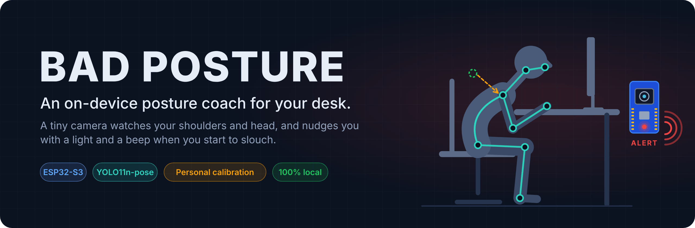
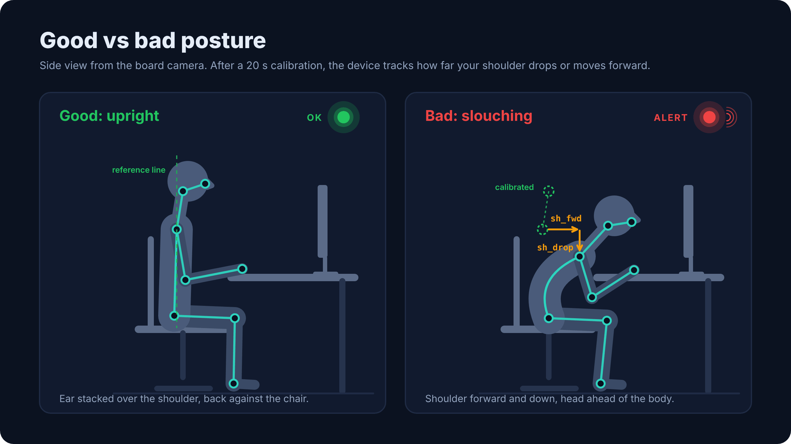
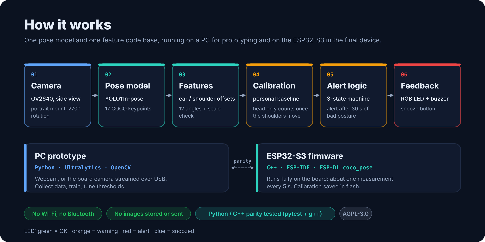

# BAD POSTURE



Capteur de posture embarque : camera + LED + buzzer sur **ESP32-S3**.
Le modele de pose YOLO11n-pose (17 keypoints COCO) extrait cou, epaules, hanches ;
12 features angulaires alimentent un petit classifieur qui sort une probabilite
de mauvaise posture ; une machine a etats declenche LED et bip.

Le meme modele de pose et le meme code de features tournent sur PC (Python) et
sur la carte (C++), donc un classifieur entraine sur PC se deploie tel quel.





```
posture/            package Python (features, regles ISO, alertes, modele)
scripts/
  collect.py        collecte labellisee depuis la webcam (g / b / espace / q)
  serial_collect.py collecte depuis la carte ESP32 via USB (camera reelle)
  autolabel.py      pre-labels par regles ISO + divergences a verifier
  train.py          regles vs regression logistique vs MLP, validation par session
  export_c.py       genere firmware/main/posture_model.h
  run.py            demo temps reel avec alertes (simule LED + buzzer)
  make_synthetic.py donnees synthetiques pour tester le pipeline
firmware/           projet ESP-IDF (XIAO ESP32S3 Sense)
tests/              pytest + parite Python / C++ (g++)
config.yaml         seuils, profils bureau / praticien
```

## Phase 1 : prototype PC (Windows)

```powershell
git clone https://github.com/mrivero-sec/posture_computervision.git
cd posture_computervision
python -m venv .venv
.venv\Scripts\activate
pip install -r requirements.txt

python scripts/run.py                      # demo immediate avec les regles ISO (sans entrainement)
python scripts/collect.py --profile desk --session bureau_01
python scripts/collect.py --profile practitioner --session cabinet_01
python scripts/train.py                    # entraine sur data/*.csv
python scripts/run.py                      # utilise maintenant models/posture_clf.joblib
python scripts/export_c.py                 # -> firmware/main/posture_model.h
```

### Avec la camera de la carte (sans Wi-Fi)

Televerser `arduino/cam_serial/cam_serial.ino` (Arduino IDE, PSRAM = OPI PSRAM), fermer le
Moniteur serie, puis regler `camera.source: "serial:COM3"` et `camera.rotate` dans `config.yaml`.
`collect.py` et `run.py` utilisent alors la carte comme une webcam (`--source 0 --rotate 0` pour la webcam du PC).

Etalonnage (touche `c`) : 5 s en bonne posture enregistrent une reference personnelle.
Les ecarts a cette reference (tete et epaule qui descendent ou avancent, en longueurs
oreille-epaule) detectent l'avachissement meme sans les hanches dans le champ. Le score
d'etalonnage est combine au classifieur par un max. Seuils dans `config.yaml > calibration`.
Mode `trunk` (defaut) : tronc d'abord, les ecarts de la tete ne comptent que si les
epaules ont bouge, pour ne pas alerter quand on regarde vers le bas ou qu'on ecrit.
Une fois etalonne, l'etalonnage remplace le classifieur (`use_model_with_calib: false`).
`run.py` ecrit un log chiffre dans `data/logs/` ; touches `f` (fausse alerte) et `m`
(alerte manquee) pour annoter, puis m'envoyer le log pour ajuster les seuils.
PC uniquement pour l'instant (pas encore porte dans le firmware).

Pour tester sans webcam : `python scripts/make_synthetic.py` puis
`python scripts/train.py --data data/synthetic` (donnees factices, pas une mesure de performance).

Conseils de collecte : camera de profil a hauteur d'epaule, 1 a 2 m ; au moins
3 sessions de 10 min par profil, en variant personne, lumiere et cote ; mimer
les mauvaises postures (tete en avant, dos voute, epaule haussee, penche sur le patient).

## Phase 2 : ESP32-S3

Carte par defaut : **Freenove ESP32-S3-WROOM CAM (N16R8)**. Brochage dans `firmware/main/config.h`.

| Fonction | Freenove | XIAO ESP32S3 Sense |
| --- | --- | --- |
| LED RGB WS2812 | GPIO48 (deja sur la carte) | D0 / GPIO1 (LED externe) |
| Buzzer piezo passif (via NPN) | GPIO21 | D1 / GPIO2 |
| Bouton vers GND | GPIO14 | D2 / GPIO3 |

Cablage du buzzer (composants du kit ELEGOO) : GPIO21 -> resistance 1 kOhm -> base
du transistor NPN ; emetteur -> GND ; collecteur -> borne - du buzzer ; borne + du
buzzer -> 3V3 (ou 5V). Bouton : une patte sur GPIO14, l'autre sur GND (pull-up interne).

```bash
# ESP-IDF >= 5.3 installe (VS Code + extension ESP-IDF, ou ESP-IDF Tools Installer)
cd firmware
idf.py set-target esp32s3
idf.py build flash monitor          # Freenove

# XIAO ESP32S3 Sense :
idf.py -D SDKCONFIG_DEFAULTS="sdkconfig.defaults;sdkconfig.defaults.xiao" build flash monitor
```

Sur la Freenove, les logs sortent sur les deux ports USB-C (UART et USB natif).
Pour changer de carte apres un premier build, supprimer `sdkconfig` ou passer par
`idf.py menuconfig` > BAD POSTURE > Carte cible.

- Sans `posture_model.h`, le firmware utilise les regles ISO.
- Bouton : appui court = pause 15 min (LED bleue), double appui = etalonner, appui long = profil bureau / praticien.
- Bouton BOOT de la carte = etalonner (sans cablage). LED blanche = decompte 3 s, cyan = mesure 20 s
  (rester droit), 2 bips = enregistre en flash, 3 bips + rouge = rate (personne mal vue).
- Une fois etalonne, la carte utilise l'etalonnage (mode trunk) a la place du classifieur, comme run.py.
- Image tournee de 270 deg par defaut (carte en portrait) : menuconfig > BAD POSTURE > Rotation camera.
- Vitesse : coco_pose 640x640 prend ~4,4 s par image sur ESP32-S3 (une mesure toutes les ~5 s).
- LED : verte = OK, orange = mauvaise posture en cours, rouge + bip = alerte.
- La carte envoie les keypoints sur USB (`KP,...`) : `python scripts/serial_collect.py --port COM5`
  permet d'entrainer avec la vraie camera et le vrai angle de montage.

## Tests

```bash
pip install pytest
python -m pytest -q      # inclut la parite Python / C++ si g++ est disponible
```

## Securite et vie privee

- Aucune image n'est envoyee sur le reseau : le firmware n'active ni Wi-Fi ni
  Bluetooth. Sur PC, le seul acces reseau est celui d'Ultralytics (telechargement
  initial de `yolo11n-pose.pt`, verification de mises a jour). Ses statistiques
  d'usage (`sync`) sont coupees au chargement du modele (`posture.keypoints.load_yolo`).
- `scripts/serial_viewer.py` peut sauver des images (touche `s`) dans
  `data/captures/`. Ce dossier, les CSV de keypoints, les logs et les
  etalonnages sont exclus par `.gitignore` : ce sont des donnees personnelles.
- Les modeles `.joblib` sont des fichiers pickle : un fichier pickle peut
  executer du code au chargement. Ne charge que des modeles que tu as
  entraines toi-meme.

## Licence

Ce projet est distribue sous licence **GNU AGPL-3.0** (voir `LICENSE`).

YOLO11n-pose (Ultralytics) est lui aussi sous AGPL-3.0 : licence commerciale
Ultralytics ou modele alternatif necessaire pour un produit vendu sous une autre
licence. Les composants Espressif (esp-dl, coco_pose) sont sous MIT. Les poids
`yolo11n-pose.pt` et les fichiers Freenove ne sont pas inclus dans ce depot.
