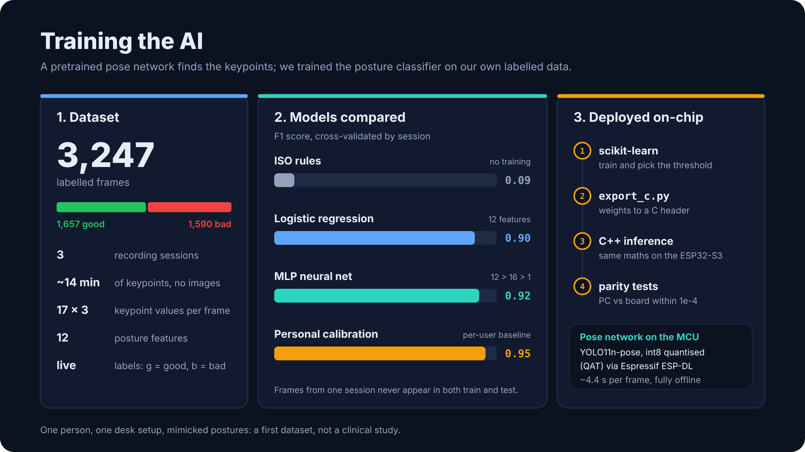

# BAD POSTURE


**An embedded machine learning project: a camera on an ESP32-S3 microcontroller
watches how you sit and warns you (LED + beep) when you start to slouch.**

Two models work together:

1. **Pose estimation (deep learning, on-chip).** YOLO11n-pose, an int8-quantised
   convolutional network, finds 17 body keypoints in each camera frame directly
   on the ESP32-S3 (Espressif ESP-DL). No cloud, no Wi-Fi.
2. **Posture classification (trained by us).** 12 geometric features computed
   from the keypoints feed a small neural network (MLP) that we trained on our
   own labelled recordings. It outputs a probability of bad posture, which drives
   an alert state machine. A personal calibration then adapts the decision to
   each user and camera setup.

Everything runs offline. No image is stored or sent anywhere.


## Machine learning pipeline



### 1. Data collection

`scripts/collect.py` runs the pose model on the live camera and records the 17
keypoints of every frame, never the image itself. Labels are given live from the
keyboard (`g` = good posture, `b` = bad posture) while mimicking typical desk
habits: head pushed forward, rounded back, leaning towards the screen, slumping
in the chair.

First dataset (side view, desk profile):

| | |
| --- | --- |
| Sessions | 3 |
| Labelled frames | 3,247 (1,657 good / 1,590 bad) |
| Recorded time | ~14 min of keypoints |
| Inputs per frame | 17 keypoints x (x, y, confidence) |

### 2. Feature engineering

Raw pixel coordinates depend on where the camera is and how far away you sit,
so `posture/features.py` turns each skeleton into 12 scale-invariant features:
neck and trunk inclination, forward head offset, nose drop, shoulder and head
tilt, lateral lean, ear-shoulder gap, view ratio (side vs front view) and hip
visibility. The exact same code exists in C++ (`firmware/main/features.cpp`)
for the microcontroller.

### 3. Training and evaluation

`scripts/train.py` compares three approaches with scikit-learn:

| Model | Training | F1 | Precision | Recall | ROC AUC |
| --- | --- | --- | --- | --- | --- |
| ISO 11226 / EN 1005-4 rules | none | 0.09 | 1.00 | 0.05 | 0.48 |
| Logistic regression | 12 features | 0.90 | 0.94 | 0.86 | 0.95 |
| **MLP neural network** (12 > 16 ReLU > 1) | 12 features | **0.92** | **0.95** | **0.90** | **0.97** |

- **Cross-validation by session** (`GroupKFold`): neighbouring frames are almost
  identical, so frames from one session never appear in both the training and
  the test set. A random split would inflate the scores.
- The simpler model wins unless the MLP is clearly better (more than 0.02 F1).
  The decision threshold is tuned on the out-of-fold predictions (0.42 here).
- The hand-written ergonomic rules barely work in a side-view desk setup (F1
  0.09), which is why a learned model is needed at all.

### 4. Personal calibration

Bodies, chairs and camera positions differ, so the device also learns a
personal reference: press `c` (PC) or the BOOT button (board), sit up straight,
and it records your baseline. Posture is then measured as the deviation from
that baseline in ear-shoulder lengths (shoulder dropping or moving forward,
head sinking or moving forward). In `trunk` mode the head only counts once the
shoulders move, so looking down at a keyboard or writing does not trigger an
alert. The calibration detects when you moved closer or further away and asks
to be redone.

| Method (same cross-validation) | F1 |
| --- | --- |
| Calibration, all deviations | 0.97 |
| **Calibration, trunk mode (default)** | **0.95** |

On a 53-minute real working session in trunk mode, the device raised 10 alerts,
all judged correct by the user, with no false alert.

### 5. Deployment on the microcontroller

- `scripts/export_c.py` exports the trained weights and the scaler to a C header
  (`firmware/main/posture_model.h`, float32).
- The firmware runs the same features, classifier, calibration and alert logic
  in C++.
- `tests/test_parity.py` compiles that C++ with g++ and checks it against the
  Python code on hundreds of synthetic skeletons: same features, same
  probabilities (within 1e-4), same alerts.
- The pose network runs on the ESP32-S3 in about 4.4 s per frame (640x640 input),
  so the board takes one measurement roughly every 5 s.

### Limitations

This is a first dataset: one person, one desk, one camera position, mimicked
postures recorded on a single day. The scores show that the approach works, not
that it generalises. More people, more setups and longer natural recordings are
the next step.

## How it works


```
posture/            Python package (features, ISO rules, alerts, model, calibration)
scripts/
  collect.py        labelled data collection from the camera (g / b / space / q)
  serial_collect.py data collection from the ESP32 board over USB (real camera)
  autolabel.py      pre-labels with the ISO rules + disagreements to review
  train.py          rules vs logistic regression vs MLP, cross-validated by session
  export_c.py       generates firmware/main/posture_model.h
  run.py            real-time demo with alerts (simulates LED + buzzer)
  make_synthetic.py synthetic data to test the pipeline
firmware/           ESP-IDF project (Freenove ESP32-S3-WROOM CAM or XIAO ESP32S3 Sense)
arduino/            hardware check and USB camera sketches
tests/              pytest + Python / C++ parity (g++)
config.yaml         thresholds, desk / practitioner profiles
```

## Phase 1: PC prototype (Windows)

```powershell
git clone https://github.com/mrivero-sec/posture_computervision.git
cd posture_computervision
python -m venv .venv
.venv\Scripts\activate
pip install -r requirements.txt

python scripts/run.py                      # instant demo with the ISO rules (no training)
python scripts/collect.py --profile desk --session desk_01
python scripts/collect.py --profile practitioner --session clinic_01
python scripts/train.py                    # trains on data/*.csv
python scripts/run.py                      # now uses models/posture_clf.joblib
python scripts/export_c.py                 # -> firmware/main/posture_model.h
```

### Using the board camera (no Wi-Fi)

Upload `arduino/cam_serial/cam_serial.ino` (Arduino IDE, PSRAM = OPI PSRAM), close the
Serial Monitor, then set `camera.source: "serial:COM3"` and `camera.rotate` in `config.yaml`.
`collect.py` and `run.py` then use the board like a webcam (`--source 0 --rotate 0` for the PC webcam).

Calibration (key `c`): 5 s in good posture record a personal reference. Thresholds
are in `config.yaml > calibration`. Once calibrated, the calibration replaces the
classifier (`use_model_with_calib: false`), on the PC and on the board.
`run.py` writes a numbers-only log to `data/logs/`; press `f` (false alert) and `m`
(missed alert) to annotate it and tune the thresholds.

To test without a camera: `python scripts/make_synthetic.py` then
`python scripts/train.py --data data/synthetic` (fake data, not a performance measure).

Collection tips: side-view camera at shoulder height, 1 to 2 m away; at least
3 sessions of 10 min per profile, varying the person, lighting and side; mimic
bad postures (head forward, rounded back, raised shoulder, leaning over a patient).

## Phase 2: ESP32-S3

Default board: **Freenove ESP32-S3-WROOM CAM (N16R8)**. Pinout in `firmware/main/config.h`.

| Function | Freenove | XIAO ESP32S3 Sense |
| --- | --- | --- |
| WS2812 RGB LED | GPIO48 (on the board) | D0 / GPIO1 (external LED) |
| Passive piezo buzzer (via NPN) | GPIO21 | D1 / GPIO2 |
| Button to GND | GPIO14 | D2 / GPIO3 |

Buzzer wiring: GPIO21 -> 1 kOhm resistor -> NPN transistor base; emitter -> GND;
collector -> buzzer (-); buzzer (+) -> 3V3 (or 5V). Button: one leg on GPIO14,
the other on GND (internal pull-up).

```bash
# ESP-IDF >= 5.3 installed (VS Code + ESP-IDF extension, or the ESP-IDF installer)
cd firmware
idf.py set-target esp32s3
idf.py build flash monitor          # Freenove

# XIAO ESP32S3 Sense:
idf.py -D SDKCONFIG_DEFAULTS="sdkconfig.defaults;sdkconfig.defaults.xiao" build flash monitor
```

On the Freenove, logs come out on both USB-C ports (UART and native USB).
To switch boards after a first build, delete `sdkconfig` or use
`idf.py menuconfig` > BAD POSTURE > Target board.

- Without `posture_model.h`, the firmware falls back to the ISO rules.
- Button: short press = snooze 15 min (blue LED), double press = calibrate, long press = desk / practitioner profile.
- Board BOOT button = calibrate (no wiring needed). White LED = 3 s countdown, cyan = 20 s recording
  (sit up straight), 2 beeps = saved to flash, 3 beeps + red = failed (person not seen well).
- Frames are rotated 270 deg by default (board in portrait): menuconfig > BAD POSTURE > Camera rotation.
- LED: green = OK, orange = bad posture building up, red + beep = alert.
- The board streams keypoints over USB (`KP,...`): `python scripts/serial_collect.py --port COM5`
  collects training data with the real camera and mounting angle.

## Tests

```bash
pip install pytest
python -m pytest -q      # includes the Python / C++ parity tests if g++ is available
```

## Security and privacy

- No image goes over the network: the firmware enables neither Wi-Fi nor
  Bluetooth. On the PC, the only network access is Ultralytics' (first download
  of `yolo11n-pose.pt`, update checks). Its usage analytics (`sync`) are turned
  off when the model loads (`posture.keypoints.load_yolo`).
- `scripts/serial_viewer.py` can save frames (key `s`) to `data/captures/`. That
  folder, the keypoint CSVs, the logs and the calibrations are excluded by
  `.gitignore`: they are personal data.
- `.joblib` models are pickle files, and a pickle file can run code when it is
  loaded. Only load models you trained yourself.

## Licence

This project is released under the **GNU AGPL-3.0** licence (see `LICENSE`).

YOLO11n-pose (Ultralytics) is also AGPL-3.0: a commercial Ultralytics licence or
another pose model is needed for a product sold under a different licence.
Espressif components (esp-dl, coco_pose) are MIT. The `yolo11n-pose.pt` weights
and the Freenove files are not included in this repository.
